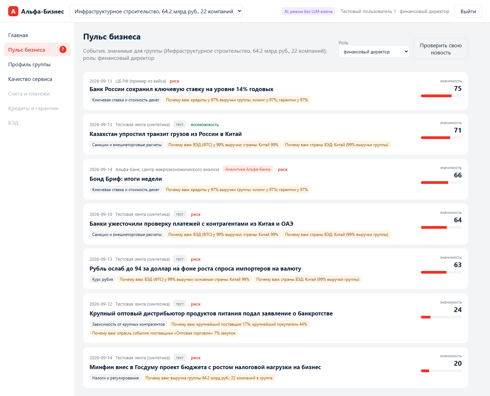

# Альфа Пульс

Сервис для руководителей крупного бизнеса в интернет-банке Альфа-Бизнес: отбирает события, которые влияют именно на их группу компаний, и объясняет, **что произошло, почему это важно этой компании, какие последствия возможны, как это оценивает Альфа-Банк, что можно сделать и на чем основан вывод**. Каждое утверждение помечено как **факт**, **позиция Альфа-Банка** или **вывод AI** и связано с первоисточником.

Кейс «Новостная аналитика для принятия бизнес-решений» (хакатон «Альфа-Будущее», Альфа-Банк × Changellenge).



## Идея
Новость не персональна сама по себе; персональным ее делает **механизм передачи**: ставка влияет через долг и лизинг, курс через ВЭД, цены на сырье через закупки и продажи. Поэтому:

1. **Профиль группы → чувствительность к 8 факторам** (ставка, курс, санкции/ВЭД, сырье, потребительский спрос, стройка/ипотека, налоги/регулирование, зависимость от контрагентов). Считается без LLM по данным банка, у каждой оценки есть объяснение («кредиты у 97% выручки группы», «ВЭД: Китай 99%»).
2. **Событие → факторы и направление** (LLM Gemma 4; без ключа - правила по справочнику).
3. **Персональное ранжирование** по объяснимой формуле с учетом роли пользователя.
4. **Агент интерпретации**: план → инструменты → общий контекст → черновик → самопроверка → исправление; позиция банка - только из его документов.

Так решение работает на ранее не показанных новостях: сопоставляются факторы, а не заученные сценарии.

## Архитектура
```
 CSV кейса ──► app/profiles.py ──► профили 341 группы (>15 млрд) + чувствительность ──┐
 PDF банка ──► scripts/render_pages.py ──► OCR (Qwen3-VL / Windows OCR) ──► app/research ─┤ SQLite
            реестр документов (даты, факторы) + проверенная таблица прогнозов (FTS5/BM25)│ (FTS5)
 RSS / тестовая лента / публикации банка ──► app/parser: дедупликация ──► событие (JSON) ┤
                                                                                         ▼
 Пользователь ──► app/api.py ──► app/ranking.py (лента) ──► app/agent (карточка, трасса, чат)
                     │                                          │ инструменты (только чтение, журнал):
                     ▼                                          │ get_client_profile, get_event,
               app/web (макет Альфа-Бизнес)                     │ get_counterparty_exposure,
                                                                │ search_bank_research, get_bank_forecast,
                                                                │ find_related_events, verify
```
Подробно: [docs/architecture.md](docs/architecture.md). API: [docs/openapi.json](docs/openapi.json) (и `/docs` у запущенного сервиса).

### Агентная логика (требование кейса)
| Требование | Реализация |
|---|---|
| Планирование | `plan_llm` (GLM-5.3-Flash) или `plan_rules`: по факторам события и чувствительности клиента выбираются инструменты и шаги |
| Работа с инструментами | `app/agent/tools.py`: 6 инструментов, только чтение, права пользователя на группу проверяются, каждый вызов в журнале `tool_log` |
| Контекст | результаты шагов накапливаются в общем контексте, черновик и проверка опираются на него |
| Самопроверка и адаптация | `app/agent/verify.py`: 7 детерминированных проверок + критик Qwen3.6; при провале - повторный поиск/исправление (до 2 итераций); если у банка нет позиции - расширенный поиск, затем честное «позиции банка нет» |
| Трассируемость | трасса по `trace_id` (план, найденные документы и страницы, прогнозы, проверки, вызовы инструментов) - кнопка «Как получен вывод» |

### Модели (только из списка кейса)
| Задача | Модель |
|---|---|
| Извлечение события | Gemma 4 26B A4B |
| План и интерпретация | GLM-5.3-Flash |
| Критик | Qwen3.6 35B A3B |
| Связи событий (резерв) | DeepSeek-V4.1-Flash |
| Распознавание сканов аналитики | Qwen3-VL-30B-A3B-Instruct |
| Уточняющие вопросы | Kimi-K2.6 |

Бюджет 500 руб./день: профили и ранжирование без LLM; событие извлекается один раз на новость, а не на клиента; карточка строится при открытии и кэшируется; токены считаются на каждом вызове, есть дневной лимит `LLM_DAILY_TOKEN_LIMIT`. Без ключа (`LLM_MODE=rules`) работает тот же цикл агента, текст собирается из справочника механизмов `app/taxonomy.py`.

## Требования к окружению
- Docker 24+ (рекомендуется) **или** Python 3.12 + `pip install -r requirements.lock`
- Для LLM-режима: адрес и ключ шлюза организаторов (OpenAI-совместимый `/chat/completions`)
- Порт 8000

## Запуск
### Docker
```bash
cp .env.example .env          # впишите LLM_BASE_URL и LLM_API_KEY (без них - режим rules)
docker compose up --build     # http://localhost:8000
```
### Локально
```bash
pip install -r requirements.lock
python -m app.cli init        # профили, индекс аналитики, тестовая лента -> data/alfa_pulse.sqlite3
uvicorn app.api:app --port 8000
```
В репозитории уже лежат агрегированные профили (`data/profiles`) и распознанный текст аналитики (`data/research/text`), поэтому сервис стартует без исходных CSV. Чтобы пересобрать всё из данных кейса:
```bash
python scripts/fetch_data.py                 # CSV и PDF кейса -> data/raw, страницы PDF -> data/research/pages
python -m app.cli build-profiles             # профили из CSV (~1,5 мин)
python -m app.cli init
```
Распознавание аналитики: в рабочем контуре `python -c "from app.research.ocr import ocr_all; ocr_all(overwrite=True)"` (Qwen3-VL); локально на Windows - `scripts/ocr_windows.ps1`.

## Переменные окружения
Все переменные с комментариями - в [.env.example](.env.example): шлюз и ключ LLM, имена моделей, `LLM_MODE`, дневной лимит токенов, `ALFA_TODAY` (дата демо, по умолчанию 2026-09-15 - аналитика банка датирована сентябрем 2026), `FETCH_NEWS=1` для фонового сбора RSS, размер и порог ленты, срок «устаревания» документов банка.

## Пошаговый сценарий проверки
1. Откройте http://localhost:8000 и выберите **«финансовый директор»** (группа: инфраструктурное строительство, 64,2 млрд руб., кредиты у 97% выручки, ВЭД с Китаем).
2. На главном экране - постоянный виджет **«Пульс бизнеса»** с главным событием и причиной «почему вам».
3. **Пульс бизнеса**: лента 3-7 событий; у каждого - значимость, фактор, «почему вам» из признаков группы, метка риск/возможность.
4. Смените **роль** (например, на «генеральный директор») - порядок ленты изменится. Выйдите и войдите как **«собственник бизнеса»** (девелопер) - лента другая: ипотека, налоги, металлопрокат.
5. Откройте событие **«Ключевая ставка ЦБ РФ…»**: шесть блоков; в блоке «Как оценивает банк» - прогноз 14,0% на конец 2026 г. и 12,0% на конец 2027 г. со ссылкой на документ и страницу, отметка «Банк обновил прогноз: было 13,5%, стало 14,0%»; ссылка открывает страницу документа банка.
6. Нажмите **«Как получен вывод»** - план агента, найденные документы, проверки, журнал инструментов.
7. В чате спросите **«Покажи по компаниям группы»**, **«Какие контрагенты затронуты?»**, **«А если ставка снизится?»**, **«На чем основан вывод?»**.
8. **«Проверить свою новость»** - вставьте любую ранее не показанную новость: сервис извлечет факторы и покажет значимость для группы; карточку можно открыть.
9. **Профиль группы**: что сервис знает о группе; уточните «плавающая ставка» = «нет» - чувствительность к ставке снизится, карточки пересчитаются.
10. **Качество сервиса**: доля карточек, прошедших каждую проверку, вызовы инструментов, токены, обратная связь.

Тестовые пользователи: `data/users.json` (6 ролей, у одного - две группы). Данные компаний - обезличенные данные кейса; новости с пометкой «тест» - синтетические (`data/news/synthetic_news.jsonl`).

## Тесты и качество
```bash
python -m unittest discover -s tests -t . -v   # 17 тестов, в т.ч. LLM-режим на имитации шлюза (tests/mock_llm.py)
python -m app.cli eval                          # метрики на эталонной разметке data/eval/gold.json
python scripts/screens.py                       # скриншоты сценария (нужен playwright и Chrome)
```
Результат на тестовой ленте, режим rules (без LLM):

| Метрика | Значение |
|---|---|
| Карточки, прошедшие все 7 проверок (факты с источником, позиция банка из документов, числа подтверждены, персонализация ≥2 признаков, полнота, разделение банк/AI, свежий прогноз) | 100% (15 из 15) |
| Признаков клиента в объяснении, в среднем | 3,4 |
| Precision@3 / Recall@3 ленты по разметке эксперта | 0,40 / 0,40 |
| Время карточки (rules) | ~60 мс |

Precision@3 - нижняя граница: правила не умеют оценивать масштаб события (сила ограничена), а разметку делала сама команда. В LLM-режиме масштаб и направление оценивает модель; метрику нужно пересчитать на ключе организаторов и на разметке экспертов банка.

**Мониторинг** (`/api/quality-stats`, вкладка «Качество сервиса»): доля карточек по каждой проверке, число итераций самопроверки, время, токены за 24 ч против лимита, ошибки инструментов, обратная связь («полезно / не про нас / ошибка в факте»). Процесс: еженедельная разметка экспертами 50 пар «клиент × событие» (Precision@5), разбор 20 худших карточек, правка весов `app/ranking.py` и справочника `app/taxonomy.py`, регресс через `app.cli eval`.

## Работа с неполными и зашумленными данными
- Профиль считается на уровне **группы**: выручку > 15 млрд имеют 115 компаний, а групп - 341.
- Признаки - **доли выручки группы**, а не «есть хоть у одной компании».
- Дубли ID, разный формат ОКВЭД (41.2/41.20), 27 тыс. самоплатежей, 34 тыс. внутригрупповых платежей, выбросы до 1,1 трлн - нормализуются или исключаются; доля контрагентов вне данных банка показывается и снижает уверенность (`data/profiles/data_quality.json`).
- Сканы аналитики: OCR + **проверенная таблица прогнозов** для чисел; шум распознавания не попадает в цитаты.
- Документы банка старше 180 дней (обзор стали 2021 г.) не выдаются как текущая позиция банка; при нескольких прогнозах берется свежий и показывается, что прогноз обновлен.
- Новость без бизнес-факторов (спорт) в ленту не попадает; перепечатки склеиваются (шинглы, Жаккар ≥ 0,5).

## Безопасность AI-компонента
- Пользователь видит только свои группы; инструменты агента вызываются с его правами.
- Инструменты только читают данные; агент не выполняет действий в банке от имени клиента.
- В промпт идут агрегаты и доли, а не платежи и идентификаторы контрагентов.
- Журнал всех вызовов моделей и инструментов (`tool_log`), трассы карточек (`traces`).
- Текст новостей передается модели как данные; ответы модели валидируются по JSON-схеме, цитаты фактов сверяются с текстом источника, числа - с источниками и профилем.

## Масштабирование и сопровождение
- Новая отрасль или фактор - запись в `app/taxonomy.py`; новый источник - адаптер в `app/parser/sources.py`; новый документ банка - строка в `data/research/docs.json` и распознавание.
- Средний бизнес - тот же профилировщик с другим порогом (`profiles.build(threshold=...)`), на уровне компании.
- Хранилище SQLite в прототипе; в рабочем контуре - PostgreSQL (полнотекстовый поиск) и очередь для сбора новостей.

## Структура
```
app/            сервис: config, db, profiles, ranking, taxonomy, llm, api, cli, evaluation
app/parser/     источники (RSS, тестовая лента, публикации банка), дедупликация, извлечение событий
app/research/   индекс аналитики банка (FTS5), OCR через Qwen3-VL
app/agent/      агент, инструменты, самопроверка, чат
app/web/        интерфейс (макет Альфа-Бизнес)
data/           профили, распознанная аналитика, прогнозы, тестовые новости, пользователи, разметка, синтетика
scripts/        загрузка данных, рендер и OCR страниц, синтетика, скриншоты, smoke-тест
tests/          автотесты и имитация LLM-шлюза
docs/           архитектура, OpenAPI, скриншоты
```

## Ограничения прототипа
- Ключ организаторов не использовался: LLM-путь проверен на имитации шлюза (`tests/mock_llm.py`), качество текстов моделей нужно проверить на реальном ключе.
- Аналитика распознана встроенным OCR Windows; в рабочем контуре - Qwen3-VL.
- RSS ЦБ РФ и Интерфакса из тестовой среды не ответили (ТАСС, РБК, Коммерсантъ работают).
- Docker-образ не собирался в среде разработки (Docker не установлен); запуск проверен локально через uvicorn.
